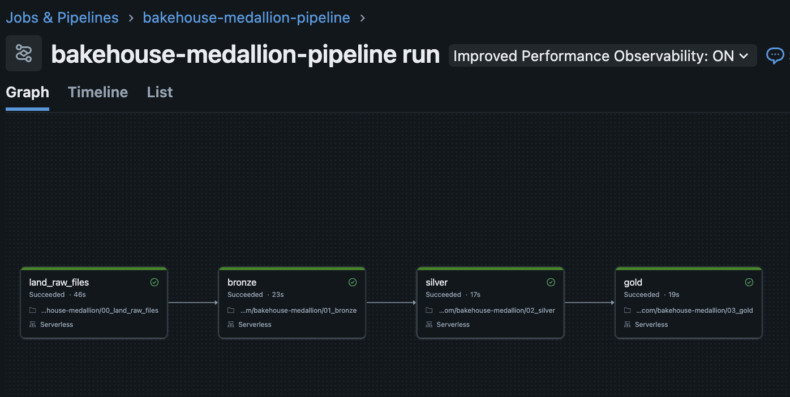
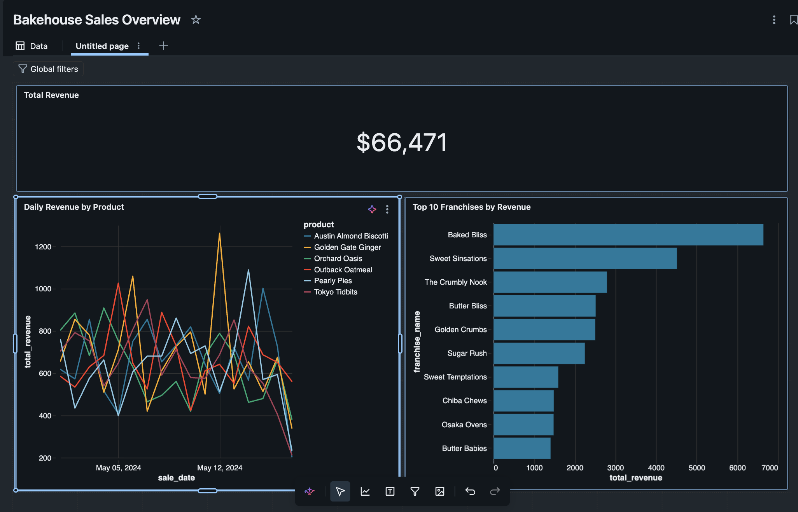

# Databricks Medallion Pipeline with Genie Code CLI

An end-to-end **Bronze → Silver → Gold** pipeline on Databricks, written, deployed and run by **Genie Code CLI** (Databricks' terminal coding agent) from VS Code, with every step reviewed and approved by me.

Follow-up to [databricks-claude-ai-integration](https://github.com/Sandarsh-M/databricks-claude-ai-integration), where I built a similar pipeline with Claude Code.



## Pipeline

```
samples.bakehouse ─► Volume files ─► Bronze ─► Silver ─► Gold
                     (JSON + CSV)    3 tables   enriched  3 business tables
```

| Step | Notebook | Does | Rows |
|---|---|---|---|
| Land | `00_land_raw_files.py` | Sample tables → JSON/CSV files in a Volume | 3,333 / 300 / 48 |
| Bronze | `01_bronze.py` | Files → Delta, as-is, with source file and load time | 3,333 / 300 / 48 |
| Silver | `02_silver.py` | Types, dedupe, card masking, joins, rejected-rows table | 3,333 (0 rejected) |
| Gold | `03_gold.py` | Revenue by franchise, daily product sales, top customers | 48 / 102 / 10 |

**Check:** revenue reconciles at **66,471.00** from source to gold. Gold fails before writing if it doesn't.

All four run as one serverless job (`resources/medallion_job.json`), manual trigger only.


## Dashboard

An AI/BI dashboard on the gold tables, built by Genie Code in the Databricks workspace from a single prompt. Total revenue matches the pipeline's 66,471.



## How Genie Code helped

- **Planned before acting** and asked approval for every Databricks command
- **Fixed its own error**: a Spark Connect issue on serverless, diagnosed and rerun without help
- **Verified results** with fresh counts and a revenue reconciliation
- **Still needed review**: I changed its plan 6 times across 5 steps, e.g. a shared folder → my user folder

Step-by-step notes: [`notes/genie-code-log.md`](notes/genie-code-log.md)

## Run it

Import `src/*.py` into your workspace, create the job from `resources/medallion_job.json` (replace the `<CATALOG>`, `<SCHEMA>` and `<WORKSPACE_USER_FOLDER>` placeholders), then `databricks jobs run-now <JOB_ID>`.

**Stack:** Databricks (Unity Catalog, Volumes, Delta, Jobs, serverless) · Genie Code CLI · Databricks CLI · VS Code · GitHub